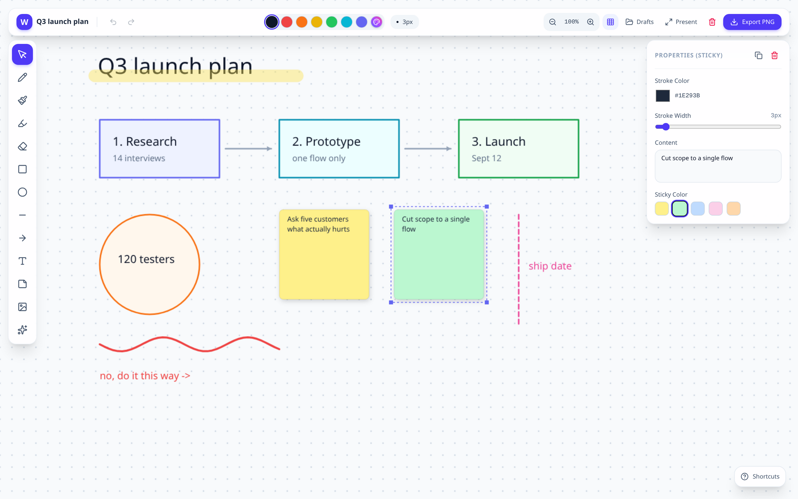

# Whiteboard Studio

A fast, dependency-light whiteboard for drawing and explaining things — built with slower, older machines in mind.



No accounts, no backend, no collaboration server. Everything is a single HTML canvas rendered with the plain Canvas 2D API, so it stays smooth on hardware that chokes on a typical Electron whiteboard app.

## Why it exists

Most browser whiteboards ship a full graphics engine (fabric.js, konva, WebGL layers) and a sync stack. This one deliberately doesn't: React for the UI, a plain `<canvas>` for the drawing surface, lucide for icons, and nothing heavier. The production bundle is ~90 kB gzipped and the render loop allocates nothing per frame it doesn't need, so it stays usable on an old laptop.

## Features

- **13 tools** — select/move, pencil, smooth brush, highlighter, eraser (removes whole elements), rectangle, circle, line, arrow, text, sticky note, image insert, laser pointer placeholder
- **Shapes with style** — 10 preset colours plus a custom picker, stroke width 1–36 px, solid/dashed/dotted strokes
- **Sticky notes** — five note colours, text edited inline in the properties panel
- **Images** — pick any image file; it's placed on the board as a movable element
- **Multiple boards** — create, rename, delete and switch boards from the Drafts panel
- **Autosave** — every change is written to `localStorage` immediately, so a refresh loses nothing
- **Undo / redo** — per-board history; live dragging doesn't flood it
- **Zoom & pan** — scroll to zoom (10 %–500 %), hold Space and drag to pan, click the percentage to reset
- **Backgrounds** — dots, grid, lines or blank, toggled from the toolbar
- **Presentation mode** — hides the whole UI chrome for a clean full-screen board, with a slim bar to exit
- **Export** — PNG (2400 × 1600 render) or a full JSON backup of all boards; JSON can be imported back

## Getting started

Requires Node.js 20.19+ (or 22.12+), as required by Vite 8.

```bash
git clone git@github.com:LimitlessCode/whiteboard-project.git
cd whiteboard-project
npm install
npm run dev      # http://localhost:3000
```

Other scripts:

```bash
npm run build    # production bundle into dist/
npm run preview  # serve the built bundle
npm run lint     # tsc --noEmit type check
npm run clean    # remove dist/
```

## Keyboard & mouse

| Input | Action |
| --- | --- |
| Space + drag | Pan the canvas |
| Mouse wheel | Zoom in / out |
| Click element (Select tool) | Select, then drag to move |
| Shift + drag | Pan (Select tool) |
| Middle mouse drag | Pan |
| In-app **Shortcuts** button | Full reference panel |

The shortcuts panel in the app also lists single-key tool hotkeys (`V`, `P`, `B`, `H`, `E`, `R`, `C`, `L`, `A`, `T`, `S`, `I`, `X`) plus `Ctrl+Z` / `Ctrl+Y` and `Delete`. Those bindings are on the roadmap below — only the mouse/touch gestures in the table above are wired up today.

## Project structure

```
src/
├── App.tsx                  # board state, history, export, modals, presentation mode
├── types.ts                 # WhiteboardElement / WhiteboardBoard models
├── components/
│   ├── CanvasArea.tsx       # canvas render loop, pointer handling, pan/zoom
│   ├── TopToolbar.tsx       # colour, stroke, zoom, backgrounds, drafts, export
│   ├── Sidebar.tsx          # tool selector
│   ├── PropertiesPanel.tsx  # per-element colour / stroke / text / sticky colour
│   ├── DraftsModal.tsx      # board manager + JSON import/export
│   ├── PresentationBar.tsx  # minimal bar shown in presentation mode
│   └── ShortcutsModal.tsx   # shortcut reference
└── utils/
    ├── canvasHelpers.ts     # element drawing, hit testing, arrow heads, text wrap
    └── storage.ts           # localStorage persistence
```

## How the data model works

Each board is a plain JSON object: `{ id, title, createdAt, updatedAt, background, backgroundColor, elements[] }`. Every element is a flat record — type, position, size, colour, stroke width, opacity, stroke style, and for freehand strokes an array of points. There is no DOM per shape and no retained graphics scene: the canvas is fully repainted from `elements` on every frame, which keeps behaviour predictable and the state trivially serialisable.

That same model is what JSON export writes and what a backend would sync, if one is ever added.

## Tech stack

- React 19 + TypeScript 7
- Vite 8 with `@vitejs/plugin-react`
- Tailwind CSS 4 (via `@tailwindcss/vite`)
- lucide-react icons
- Canvas 2D for all drawing

## Privacy

Boards never leave the browser. Imported images are stored as data URLs inside `localStorage`, the same place the boards live — nothing is uploaded anywhere. Clearing site data deletes your boards, so use **Drafts → Export JSON** for anything worth keeping.

## Roadmap

- Wire up the single-key tool hotkeys, `Ctrl+Z` / `Ctrl+Y` and `Delete` that the shortcuts panel advertises
- Working laser pointer (the tool is in the toolbar, behaviour is not implemented)
- Keyboard nudging and multi-select
- Optional file-based persistence (import/export already works)
- Touch and stylus pressure support

## License

No license file is included yet — treat it as all rights reserved until one is added.
